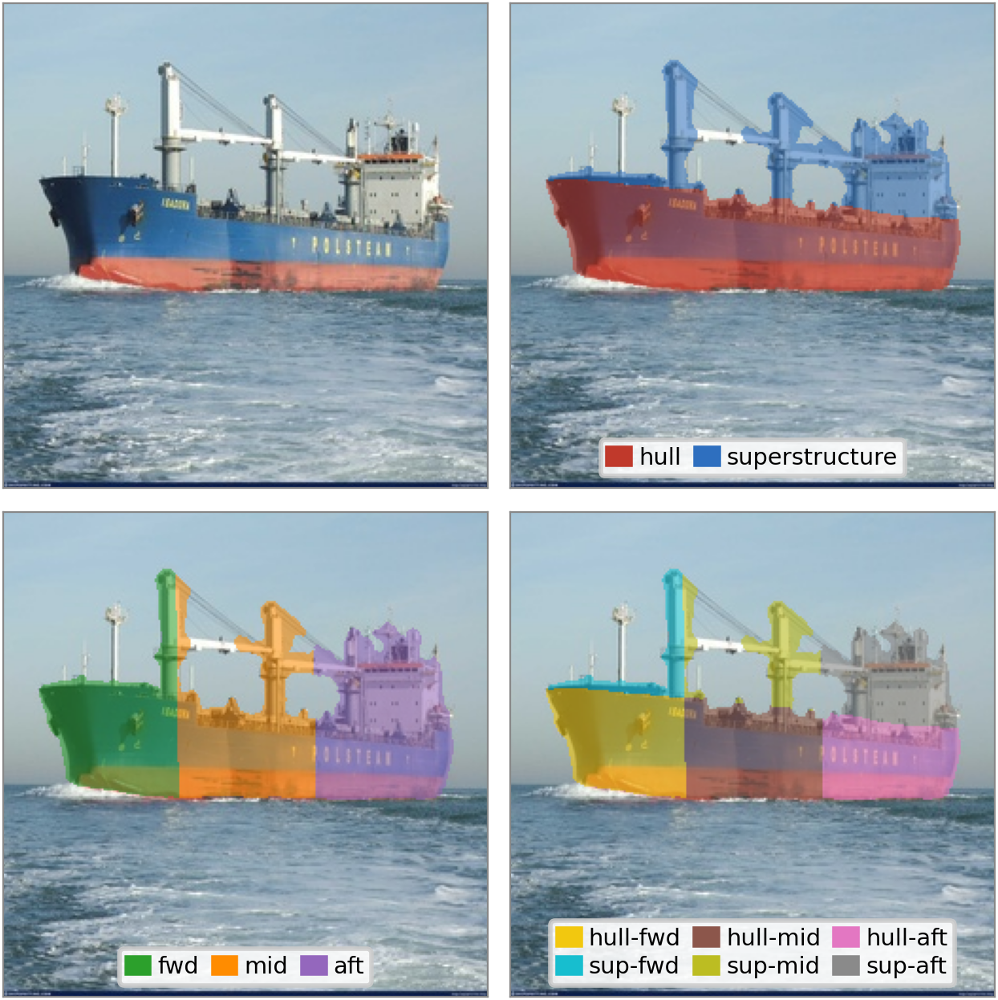
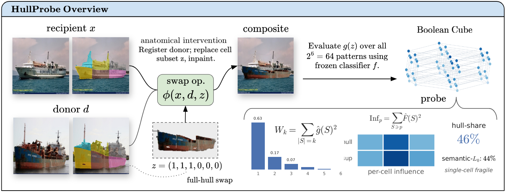

<h1 align="center"><b>HullProbe: Measuring Interventional Part Reliance<br>in Maritime Vessel Classifiers</b></h1>

<p align="center">
  <b>Faisal Mohammad</b><sup>1,2</sup> &nbsp;&nbsp;&nbsp; <b>Mohamed Younis</b><sup>1</sup>
  <br>
  <sup>1</sup>University of Maryland, Baltimore County &nbsp;&nbsp;&nbsp;
  <sup>2</sup>Johns Hopkins University Applied Physics Laboratory
</p>

<p align="center">
  <b>WACV 2027 &nbsp;·&nbsp; Main Conference &nbsp;·&nbsp; Evaluation &amp; Dataset Track</b>
</p>

<p align="center">
  
  
  <a href="https://github.com/fossil-ai/HullProbe/releases"></a>
  
  <a href="LICENSE"></a>
</p>

<p align="center">
  
</p>
<p align="center"><em>
  A learned segmenter splits a vessel into hull and superstructure; its PCA pose axis splits it into
  forward, mid, and aft thirds. Their product is a 2&times;3 grid of anatomical cells, each registrable
  and swappable for another vessel's.
</em></p>

---

## Overview

De-biasing methods claim to remove a classifier's reliance on spurious cues, but they are certified
with **worst-group accuracy**, a proxy that needs group labels and only *infers* reliance from
accuracy. **HullProbe measures the reliance directly.** It replaces a registered anatomical part of
a real vessel with another vessel's corresponding part and reads how much that swap moves a frozen
classifier's decision, using a same-class swap to cancel compositing artifacts. Because the six-cell
lattice has only 2<sup>6</sup> = 64 swap patterns, the audit is exhaustive, and a single
Walsh&ndash;Hadamard transform returns each part's interventional influence and the full interaction
spectrum.

### Highlights

- **Validated where the ground truth is known.** On planted shortcuts, HullProbe tracks worst-group
  accuracy (r = &minus;0.94 over 45 configurations for the part-swap operator, &minus;0.97 for
  appearance shortcuts), and a known-null shortcut reads near zero.
- **Robust to its segmenter.** Replacing the learned hull/superstructure segmenter with human
  annotations changes the hull-share by &minus;0.009 (95% CI [&minus;0.041, 0.023]).
- **A natural classifier leans on the hull, but is not ruled by it.** A ConvNeXt-Tiny on the 26
  vessel types of MARVEL places **46%** [41, 52] of its corrected sensitivity on the hull, yet follows
  the superstructure 73% of the time when the two conflict.
- **Group-label-free de-biasing does not move it.** JTT, LfF, AFR, CutMix, and hull randomization
  leave the hull-share unchanged within the audit's ~0.04 resolution; group-supervised DFR removes
  planted shortcuts.
- **General beyond one model and one domain.** The picture holds for ConvNeXt-Tiny, ResNet-50, and
  ViT-B/16 and on SeaShips, and the protocol ports to Stanford Cars with a five-part decomposition.

## How it works

<p align="center">
  
</p>

1. **Decompose.** A SegFormer-B2 fine-tuned on 1,014 annotated vessels splits the vessel silhouette
   into hull and superstructure; the PCA pose splits it into forward, mid, and aft thirds.
2. **Swap.** The operator &phi;(x, d, z) replaces any subset z &isin; {0,1}<sup>6</sup> of a
   recipient's cells with a donor's registered cells, stencilled onto the recipient's exact support.
3. **Evaluate.** The frozen classifier is run on all 64 composites for K = 4 cross-class donors and
   2 same-class controls per recipient.
4. **Read out.** Per-cell influence Inf<sub>p</sub> (cross-class minus same-class), the hull-share,
   the functional-ANOVA spectrum W<sub>k</sub>, and the semantic-L<sub>0</sub> radius.

## Repository layout

```
hullprobe/          the method as an installable package
  audit.py            model-agnostic cube, influence, Walsh spectrum, semantic-L0, hull-share
  lattice.py          2x3 part lattice   ·   lattice_align.py  per-cell registration, 64 composites
  pose.py             PCA pose, fwd/mid/aft thirds   ·   canonical.py  hull/superstructure masks
  segformer_segmenter.py, segmenter.py   hull/superstructure segmenter and region-map I/O
scripts/            one experiment per file (see "Reproducing the paper")
paper/              figure generators: read experiments/*.json, write paper/figures/
experiments/        result JSONs behind every table and figure (with per-recipient records)
protocol/           fixed recipient and donor lists, and the segmenter's train/val split
data/annotations/   1,014 hull/superstructure annotations (label maps; no imagery)
tools/              maintainer script that builds the release assets
tests/              CPU test suite on synthetic vessels
```

## Installation

```bash
git clone https://github.com/fossil-ai/HullProbe.git && cd HullProbe
python -m venv .venv && source .venv/bin/activate
pip install -e ".[seg,dev]"        # core + SegFormer (transformers) + pytest
pytest -q                          # 37 pass, 1 optional skip
```

Python 3.10 or newer. A GPU is needed only to run audits or train models.

## Quick start (no data, no GPU)

Every figure and table rebuilds from the shipped results:

```bash
python paper/make_fig_validation.py     # Fig. 4   convergent validity vs. worst-group accuracy
python paper/make_fig_degree.py         # Fig. 5a  interaction spectrum
python paper/make_fig_semL0.py          # Fig. 5b  semantic-L0 fragility
python -m scripts.gt_mask_tables        # Table 4  annotations vs. segmenter
```

## Data and released assets

1. **MARVEL images.** Obtain the MARVEL dataset from its authors
   ([marveldataset2016](https://github.com/avaapm/marveldataset2016)); HullProbe uses subset B
   (26 vessel types). Only images are needed; no imagery is redistributed here.
2. **Release assets.** Download from the [Releases](https://github.com/fossil-ai/HullProbe/releases)
   page:

   | File | Contents |
   |---|---|
   | `hullprobe_manifests.tar.gz` | per-vessel pose manifest and MARVEL-B labels/splits |
   | `hullprobe_silhouettes.tar.gz` | zero-shot vessel silhouettes (34,768 vessels) |
   | `hullprobe_region_maps.tar.gz` | hull/superstructure region maps from the fine-tuned segmenter |
   | `segformer_b2_hullsup.pt` | the hull/superstructure SegFormer-B2 |
   | `convnext_tiny_marvel.pt` | attribution classifier (77.6%) |
   | `resnet50_marvel.pt`, `vit_b16_marvel.pt` | cross-architecture classifiers |

3. **Install them** into the checkout (writes `data/pose_B.json`, links region maps and checkpoints):

   ```bash
   python -m scripts.setup_assets --assets /path/to/downloaded/assets \
       --marvel-root /path/to/MARVEL_images1
   ```

The 1,014 annotations ship in `data/annotations/` and the recipient and donor identities behind every
reported number in `protocol/`, so the swap cubes are regenerated exactly from the public images.

## Reproducing the paper

After installing the assets, each result is one script, run from the repository root as a module
(e.g. `python -m scripts.headline_spectrum`); outputs land in `experiments/`.

| Result | Script |
|---|---|
| Hull-share, spectrum, fragility, per-cell influence (Secs. 5.1&ndash;5.2, Fig. 5, Table 8) | `scripts/headline_spectrum.py` |
| Annotations vs. segmenter (Sec. 4.3, Table 4) | `scripts/gt_mask_audit.py` |
| Donor and boundary robustness (Table 5) | `scripts/sensitivity.py` |
| Component swap probe (Sec. 5.1) | `scripts/causal_swap_probe.py` |
| Sensitivity vs. sufficiency (Sec. 5.3, Fig. 6) | `scripts/conflict.py` |
| Planted shortcuts, appearance and operator (Sec. 4.2, Fig. 4, Table 2) | `scripts/phase2_controlled.py`, `scripts/phase2_anatomical.py` |
| Circularity control (Table 7) | `scripts/phase2_circularity.py` |
| De-biasing audit (Sec. 5.4, Table 3, Fig. 7) | `scripts/train_arms_multiseed.py`, `train_lff.py`, `afr_natural.py`, `part_lattice_debias_multiseed.py` |
| Absolute influence and fixed-recipient checks (Table 11) | `scripts/debias_absinf.py`, `scripts/debias_softmargin.py` |
| Correlational attribution (Table 12) | `scripts/attribution_compare.py` |
| Architectures (Sec. 5.5) | `scripts/arch_hullshare.py` |
| SeaShips (Sec. 5.5, Fig. 12) | `scripts/seaships_{prep,segment,pose,lattice}.py` |
| Stanford Cars (Sec. 5.5, Figs. 8&ndash;11, Tables 13&ndash;14) | `scripts/cars/` |

<details>
<summary><b>Training everything from scratch</b></summary>

```bash
# vessel silhouettes and the pose manifest (the release ships these)
python -m scripts.build_vessel_silhouettes --manifest data/marvel_b/manifest_pose_maskpca.json
python -m scripts.import_region_manifests --pose data/marvel_b/manifest_pose_maskpca.json \
       --regions data/marvel_b/silhouettes.json --out data/pose_B.json

# hull/superstructure segmenter (45 epochs, seeded 812/202 split), then region maps for all vessels
python -m scripts.train_segformer --annotations data/annotations/annotations.json \
       --manifest data/pose_B.json --out experiments/segformer
python -m scripts.predict_hull_segmenter --manifest data/pose_B.json \
       --checkpoint experiments/segformer/best.pt --out-dir data/predictions --arch segformer

# classifiers under audit
python -m scripts.train_baseline_classifier --arch convnext_tiny     # also resnet50, vit_b_16
```

New annotations can be collected with `scripts/review_server.py`, the accept/adjust/reject loop used
to build `data/annotations/`.
</details>

## Audit your own classifier

HullProbe needs only predicted labels. Score any 26-class MARVEL-B model on the published pool:

```bash
python -m scripts.audit_classifier --arch resnet50 --checkpoint my_model.pt
```

or wrap any model in a `predict` function and use the API directly:

```python
from hullprobe import audit

def predict(images):                       # list of HxWx3 uint8 arrays -> predicted class indices
    ...

records, pool = audit.load_records(), audit.load_pool()        # data/pose_B.json, protocol/*.json
results = [audit.audit_recipient(predict, records, e) for e in pool["recipients"]]
print(audit.summarize([r for r in results if r]))               # hull-share, W1, W<=2, Pr[r=1], CIs
```

**New domains.** A domain needs an exhaustive partition into a few named parts, a closed-form frame
registering each part across instances, and a held-out donor pool; the operator, artifact control,
cube, and readouts carry over unchanged. `scripts/cars/` is a complete worked port (GroundedSAM parts,
PCA registration, a 2<sup>5</sup> cube), and Table 15 of the supplement lists every requirement.

## Citation

```bibtex
@inproceedings{mohammad2027hullprobe,
  title     = {{HullProbe}: Measuring Interventional Part Reliance in Maritime Vessel Classifiers},
  author    = {Mohammad, Faisal and Younis, Mohamed},
  booktitle = {Proceedings of the IEEE/CVF Winter Conference on Applications of Computer Vision (WACV)},
  year      = {2027}
}
```

## License

Code and annotations are released under the [MIT License](LICENSE). The MARVEL, SeaShips, and
Stanford Cars images remain under their original terms and are not redistributed.
